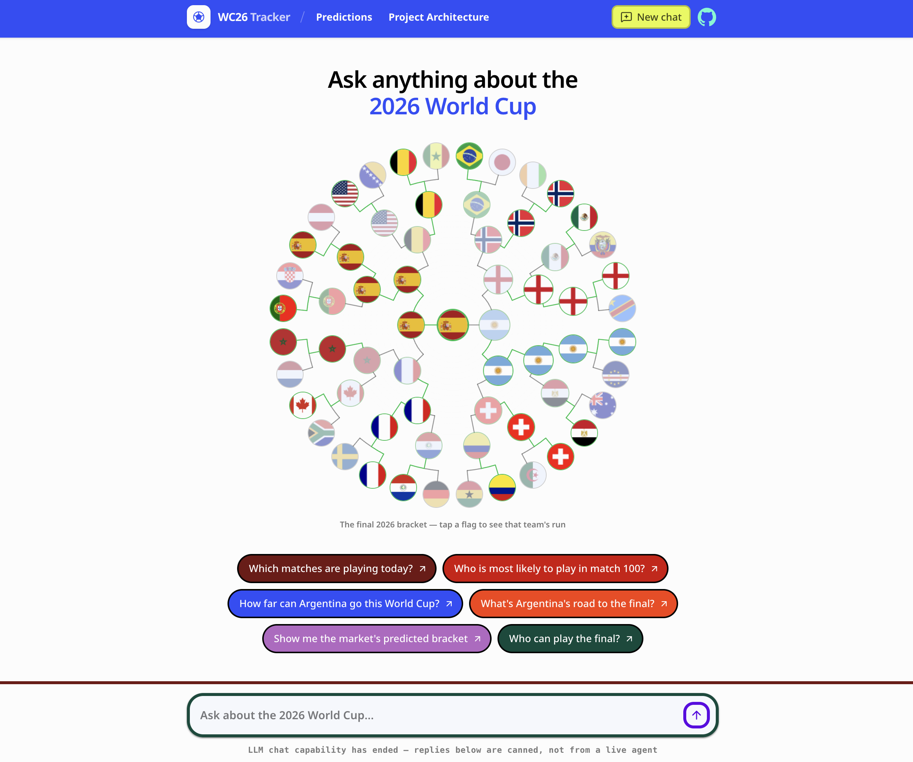
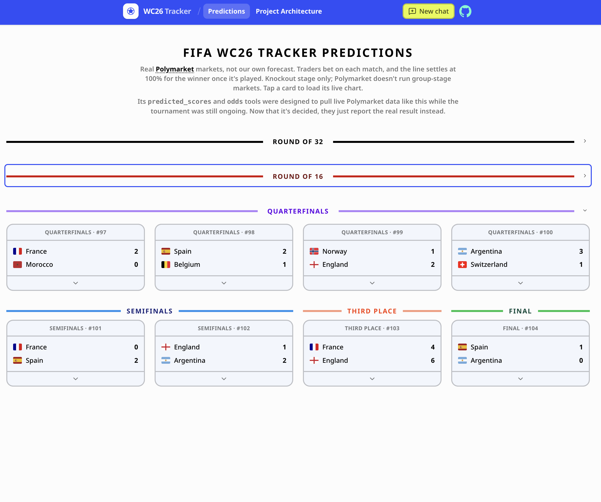

# World Cup ADK

A [Google ADK](https://adk.dev) agent for answering questions about the World Cup, served over
FastAPI with a Vite + React frontend.





The 2026 World Cup has ended, so this public snapshot ships with live chat turned off by default
(`VITE_CHAT_ENABLED=false`). The composer still works: it answers a few basics (the final, third
place, the semifinals) from a small static responder instead of a live model. Set
`VITE_CHAT_ENABLED=true` in `frontend/.env.local` and add an OpenRouter key to bring the live agent
back.

## Highlights

- 🧠 `wc26_chat`: a Python ADK `Agent` (any OpenRouter model, via LiteLlm) with 7 typed tools for
  fixtures, standings, and match results
- ⚡ FastAPI backend (`get_fast_api_app`) exposing the agent's session/run endpoints
- 💬 React SPA (Vite, `react-router-dom`) talking to the backend over HTTP/SSE
- 📊 A Predictions page embedding real Polymarket market widgets for the knockout stage

## Status

The 2026 World Cup is over, so this app answers from the real, final tournament data instead of
live sources. All seven tools in `backend/agents/wc26_chat/tools.py` report real results: fixtures,
standings, and match events (goals, cards, substitutions) were pulled once from ESPN after the
tournament ended and saved as static data (see `backend/agents/wc26_chat/data.py` and the export
scripts in `backend/scripts/` and `frontend/scripts/`). No live network calls happen while the app
runs.

Two of those tools, `predicted_scores` and `odds`, were designed to pull live Polymarket data to
forecast a match while the tournament was still ongoing. Since every match is decided now, there's
nothing left to forecast, so they just report the real result instead. The only place this app
still touches Polymarket is the Predictions page, which embeds their public widget directly for
each knockout match (see `frontend/src/lib/polymarket-2026.ts`).

This same shape (an ADK agent with typed tools over a tournament's schedule and results) could be
pointed at a different sport or league with a new data source and prompt. An ongoing tournament
would use its real live feeds instead of a one-time historical export: other FIFA competitions, or
other sports entirely such as the NFL, NBA, or a football league like the Premier League.

## Layout

```
backend/    FastAPI app + the ADK agent (Python)
frontend/   Vite + React SPA (TypeScript)
lib/        Original TS domain logic — reference for the Python port, not run directly
hooks/      A couple of framework-agnostic React hooks, same status as lib/
```

See `AGENTS.md` for the full breakdown.

## Requirements

- Python 3.11+ and Bun
- An [OpenRouter](https://openrouter.ai/keys) API key for the backend (any model works — see
  `backend/.env.example`)

## Development

Backend:

```bash
cd backend
source .venv/bin/activate      # first time: python3 -m venv .venv && pip install -r requirements.txt
cp .env.example .env           # then paste your OPENROUTER_API_KEY into .env
uvicorn main:app --reload --port 8000
```

`.env` is loaded automatically on startup (ADK walks up from `agents/` looking for one) — no
`export` needed. `.env` is gitignored; `.env.example` is the committed template.

Frontend:

```bash
bun install                    # once, at the repo root (shared @types/node for tsconfig.node.json)
cd frontend
bun install
bun run dev
```

## Scripts

```bash
# frontend/
bun run typecheck
bun run format:check
bun run build

# backend/ (.venv activated)
uvicorn main:app --reload --port 8000
```
